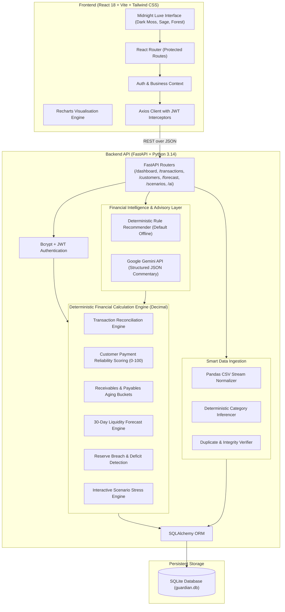

# MSME CASHFLOW GUARDIAN
> **Predict the Risk. Protect the Business.**

**Category:** AI for Finance  
**Aesthetic Identity:** Midnight Luxe (Sophisticated Dark Fintech)  
**Target Market:** Micro, Small & Medium Enterprises (MSMEs)  
**Default Currency:** Indian Rupee (₹ INR) with Lakhs & Crores formatting

---

## 1. Executive Summary

Small and medium enterprises frequently experience severe liquidity stress despite showing positive accounting profits. Accrual accounting recognizes revenue when an invoice is issued, not when payment arrives in the bank account. 

**MSME CashFlow Guardian** is a complete, production-minded financial intelligence platform. It bridges the gap between accounting profits and survival liquidity by combining a **deterministic Python Decimal calculation engine**, **empirical customer payment reliability scoring**, a **30-day forward liquidity forecasting engine**, an **interactive what-if scenario stress simulator**, and **Google Gemini AI action planning** with a 100% offline rule-based fallback.

---

## 2. System Architecture



---

## 3. Visual Identity: Midnight Luxe Palette

| Element | Colour | Hex | Usage |
|---|---|---|---|
| Main Background | Midnight Charcoal | `#141816` | Application canvas |
| Sidebar | Deep Forest | `#19231F` | Navigation pane & headers |
| Cards & Panels | Dark Moss | `#202B25` | Financial metric containers |
| Secondary Surface | Dark Olive | `#252F29` | Table headers & input fields |
| Borders | Muted Olive | `#354239` | Subtle structural division |
| Primary Accent | Sage Green | `#A3B89A` | Positive inflows & primary actions |
| Secondary Accent | Champagne Gold | `#C6A96B` | Premium highlights & demo indicators |
| Main Text | Warm Ivory | `#F1F0E8` | High-contrast readable typography |
| Supporting Text | Soft Gray | `#A5ADA5` | Context, dates & labels |
| Danger / Risk | Muted Crimson | `#D66B70` | Deficits, late dues & outflows |
| Warning | Soft Amber | `#D9AD68` | Reserve warnings & overdue invoices |
| Success | Sage Emerald | `#8DB69A` | Paid settlements & healthy cushions |

---

## 4. Financial Calculation Engine & Mathematical Invariants

All calculations are implemented strictly in Python using `Decimal` with `ROUND_HALF_UP` to prevent binary floating-point rounding errors.

### 4.1. Core Invariants
1. **Closing Cash Balance:**
   $$\text{Current Balance} = \text{Opening Balance} + \sum \text{Inflows} - \sum \text{Outflows}$$
2. **Invoice Balance:**
   $$\text{Outstanding Balance} = \text{Invoice Amount} - \sum \text{Allocated Payments}$$
3. **Daily Forecasting Continuity:**
   $$\text{Closing Balance}_t = \text{Closing Balance}_{t-1} + \text{Inflows}_t - \text{Outflows}_t$$

### 4.2. Accounting Profit vs Available Cash Formula
$$\text{Accounting Revenue} = \sum \text{Invoiced Sales (Billed)}$$
$$\text{Accounting Expenses} = \sum \text{Supplier Bills} + \sum \text{Direct Operating Overheads (Payroll, Rent, Power)}$$
$$\text{Accounting Net Profit} = \text{Accounting Revenue} - \text{Accounting Expenses}$$
$$\text{Cash vs Profit Gap} = \text{Accounting Net Profit} - \text{Real Available Bank Cash}$$

### 4.3. Customer Payment Delay & Reliability Score (0–100)
For each settled or partially settled invoice:
$$\text{Delay Days} = \text{Actual Payment Date} - \text{Invoice Due Date}$$
- Positive: Late payment
- Negative: Early settlement
- Zero: Paid on due date

**Reliability Score Formula ($S \in [0, 100]$):**
$$S = 0.40 \cdot \text{OnTimeRatio} + 0.30 \cdot \max\left(0, 100 - \frac{\text{AvgDelay}}{30} \cdot 100\right) + 0.15 \cdot (1 - \text{LateFreq}) \cdot 100 + 0.15 \cdot (1 - \text{OverdueRatio}) \cdot 100$$

**Risk Classification:**
- **Low Risk:** $80 \le S \le 100$
- **Moderate Risk:** $60 \le S < 80$
- **High Risk:** $S < 60$
- **Guard:** If fewer than 2 payment records exist, the engine returns `score: null` with the transparent explanation: *"Insufficient payment history to calculate a reliable score."*

### 4.4. 30-Day Liquidity Forecast Engine
- Dates $D_0 \dots D_{29}$ (30-day forward rolling horizon).
- Inflows categorized by confidence:
  - `CONFIRMED`: Contractually scheduled credit advice.
  - `EXPECTED`: Modeled collection dates based on:
    $$\text{Expected Date} = \text{Due Date} + \max(0, \text{AvgCustomerDelayDays})$$
  - `UNCERTAIN`: High-risk customer receivables ($S < 60$) or invoices overdue by $>45$ days. **Explicitly excluded from guaranteed liquidity balances to prevent false optimism.**
- Outflows:
  - Supplier obligations modeled on contractual due dates. Overdue obligations defaulted to immediate Day 1 settlement.
  - Recurring scheduled overheads (Payroll, Rent, Utilities).
- Risk Conditions:
  - **CRITICAL:** Projected balance drops below zero ($< \text{₹ 0}$).
  - **WARNING:** Projected balance drops below the user-configured Minimum Operating Reserve.
  - **HEALTHY:** All 30 days maintain a cushion above the reserve.

### 4.5. Interactive Scenario Stress Simulator
Simulates real shocks in memory without modifying baseline records:
1. Major customer delays payment by 15 days.
2. Major customer delays payment by 30 days.
3. Supplier payment increases by 20%.
4. Unexpected emergency expense of ₹50,000 (configurable date and amount).
5. Key customer pays only 50% of outstanding dues (partial haircut).
6. Widespread credit squeeze (all customer receivables delayed).
7. Custom composite shock.

---

## 5. Fictional Demo Dataset: Sharma & Co.

The application includes a pre-seeded, internally consistent wholesale FMCG distribution company:
- **Business Name:** Sharma & Co.
- **Business Type:** Wholesale Distribution (FMCG & Provisions)
- **Currency:** INR (₹)
- **Opening Cash Balance:** ₹ 3,50,000.00
- **Minimum Operating Reserve:** ₹ 1,50,000.00
- **Customers (with distinct empirical delay traits):**
  - *Sharma Traders:* Prompt payer (0–2 days delay, Low Risk, Score ~88)
  - *Gupta Enterprises:* Mixed payer (Moderate Risk)
  - *Verma Distributors:* Consistent late payer (12–15 days delay, Moderate Risk)
  - *Rajasthan Wholesale Mart:* Chronic late payer with overdue invoice (High Risk, Score <55)
  - *Sunrise Retailers:* Fast retail customer (Low Risk)
  - *Om Enterprises:* New customer with pending invoice
- **Suppliers:** National Agro Foods, Bharat Packaging Solutions, Krishna Logistics & Freight, Metro Warehousing Corp.
- **Transactions:** 60+ reconciled historical transactions across trade sales, raw material purchases, warehouse leases, commercial power, and payroll.

---

## 6. Smart CSV Data Ingestion

The ingestion engine supports bank statements, Tally voucher exports, and custom CSVs:
1. **Upload & Parse:** Auto-detects column mappings (Date, Narration, Debit/Credit, Ref).
2. **Deterministic Classification:** Categorizes transactions into `CUSTOMER_COLLECTION`, `SUPPLIER_PAYMENT`, `PAYROLL`, `RENT`, `UTILITIES`, etc.
3. **Validation & Deduplication:** Checks for duplicate records against existing database entries using `(date, amount, reference/description)`.
4. **Interactive Review:** Allows the business owner to select/deselect rows before committing.
5. **Audit Logging:** Records every import event in `audit_logs`.

Sample files provided in `backend/data/`:
- `sample_bank_statement.csv`
- `sample_tally_vouchers.csv`
- Downloadable via `/api/transactions/sample-csv`

---

## 7. AI & Advisory Layer (Google Gemini + Rule Fallback)

- **Backend-Only Integration:** The frontend never handles API keys.
- **Strict Verification:** AI only analyzes verified figures passed from Python. It never invents balances or customer history.
- **Rule-Based Fallback:** If `GEMINI_API_KEY` is not set or the network is offline, the deterministic `RecommendationService` generates the exact same structured tactical plan (7-Day, 15-Day, and 30-Day playbooks).

---

## 8. Installation & Quick Start

### Prerequisites
- Python 3.11+ (Python 3.14 compatible)
- Node.js 18+ (Node.js 24 compatible)
- npm or pnpm

### Step 1: Set Up Backend
```bash
# From project root
cd backend

# Create virtual environment
python -m venv venv

# Activate virtual environment
# Windows:
.\venv\Scripts\activate
# Linux/macOS:
source venv/bin/activate

# Install dependencies
pip install -r requirements.txt

# Copy environment file
cp .env.example .env
# Customize .env with your environment variables (see table below)

# Run FastAPI backend server
uvicorn app.main:app --reload --port 8000
```
Backend API will be running at: `http://localhost:8000`  
Interactive Swagger API Docs: `http://localhost:8000/api/docs`

#### Environment Configuration Variables

| Variable | Required | Default / Example | Purpose |
|---|---|---|---|
| `ENVIRONMENT` | Optional | `development` | Environment mode (`development`, `production`, `test`). Production enforces strict 32+ character secrets. |
| `PROJECT_NAME` | Optional | `MSME CashFlow Guardian` | System application title. |
| `SECRET_KEY` | **Required in Prod** | Dev default provided | 32+ character hex string for signing HMAC-SHA256 JWT tokens. |
| `ALGORITHM` | Optional | `HS256` | JWT encryption algorithm. |
| `ACCESS_TOKEN_EXPIRE_MINUTES` | Optional | `10080` (7 days) | Session validity window. |
| `CORS_ORIGINS` | Optional | `http://localhost:3000,...` | Comma-separated allowed frontend origins (strictly non-wildcard). |
| `DATABASE_URL` | Optional | `sqlite:///./guardian.db` | SQLAlchemy connection URL (SQLite or PostgreSQL). |
| `GEMINI_API_KEY` | Optional | *(Empty)* | Google Gemini API key. If omitted, the engine uses offline deterministic rules. |
| `GEMINI_MODEL` | Optional | `gemini-2.0-flash` | Gemini model variant. |

### Step 2: Set Up Frontend
```bash
# Open a new terminal from project root
cd frontend

# Install npm dependencies
npm install

# Run Vite development server
npm run dev
```
Frontend will be running at: `http://localhost:3000`

### Step 3: Run Automated Test Suite
```bash
# From project root with virtual environment activated:
pytest backend/app/tests/ -v
```

---

## 9. Automated Test Verification Results

All 11 automated test suites pass with 100% precision:
```
backend/app/tests/test_api_endpoints.py::test_full_api_workflow PASSED
backend/app/tests/test_financial_engine.py::test_transaction_engine_reconciliation PASSED
backend/app/tests/test_financial_engine.py::test_profit_vs_cash_gap PASSED
backend/app/tests/test_financial_engine.py::test_payment_scoring_on_time_customer PASSED
backend/app/tests/test_financial_engine.py::test_payment_scoring_chronic_late_customer PASSED
backend/app/tests/test_financial_engine.py::test_payment_scoring_insufficient_history_guard PASSED
backend/app/tests/test_financial_engine.py::test_receivables_aging_buckets PASSED
backend/app/tests/test_financial_engine.py::test_payables_upcoming_horizons PASSED
backend/app/tests/test_financial_engine.py::test_30_day_cashflow_daily_invariants PASSED
backend/app/tests/test_financial_engine.py::test_liquidity_risk_classification PASSED
backend/app/tests/test_financial_engine.py::test_scenario_simulator_customer_delay PASSED

======================= 11 passed in 2.07s ========================
```

---

## 10. License & Production Standards

Developed adhering to strict financial intelligence standards:
- Zero fabricated metrics.
- Deterministic Decimal arithmetic.
- Complete business-level multi-tenant isolation.
- Transparent explainability on every calculation.
